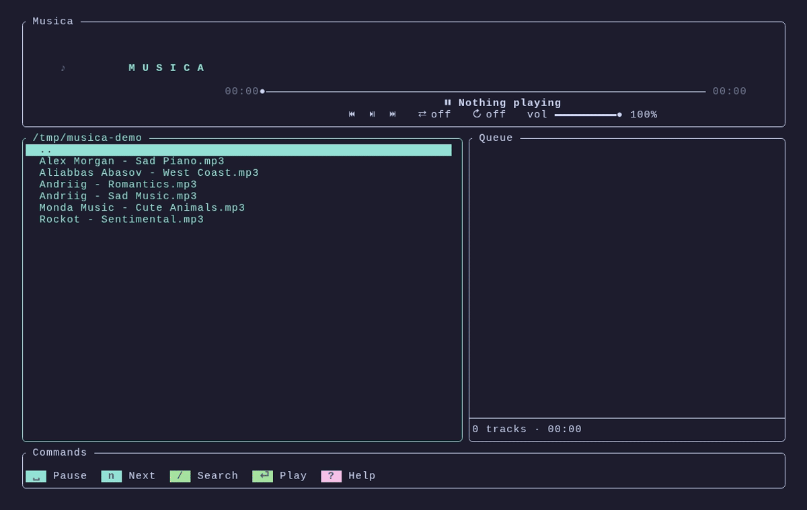

# Musica

Un lecteur de musique en terminal pilotable au clavier et à la souris, écrit
en C++20, avec pochettes, spectre en temps réel et navigateur de dossiers.

**English: [README.md](README.md)**



## Fonctionnalités

- Navigateur de dossiers et file d'attente côte à côte
- Lecture séquentielle, shuffle et répétition
- Fichiers MP3, FLAC, WAV, Ogg Vorbis, M4A/AAC et Opus
- Pochettes depuis les tags intégrés, ou depuis `front.*`, `cover.*`,
  `folder.*` ou `album.*` (JPEG ou PNG) à côté de la piste, chargées en
  arrière-plan
- Spectre multi-lignes en temps réel
- Barres de position et de volume interactives (clic, glisser, molette)
- Recherche `/` en direct dans le panneau actif (insensible à la casse et aux accents)
- Popup d'infos de la piste, édition de la file (retirer, déplacer)
- Playlists M3U : créer, ajouter, charger, renommer, supprimer avec confirmation
- Interface française / anglaise, détectée depuis la locale ou mémorisée
- Les fichiers illisibles sont ignorés avec un message visible
- Souris, et `--no-mouse` pour sélectionner du texte dans le terminal
- Mémorise le dernier dossier, le volume, shuffle, répétition et la langue
- Adapté aux petits terminaux : mise en page compacte sous 80×24, message clair sous 40×12

## Compilation

Nécessite un compilateur C++20, CMake ≥ 3.20, et zlib pour TagLib. FTXUI et
TagLib sont téléchargés par CMake ; miniaudio et stb_image sont fournis dans le
dépôt.

```sh
cmake -B build -DCMAKE_BUILD_TYPE=Release
cmake --build build
./build/musica

# installer le binaire, la page de manuel et la documentation
sudo cmake --install build
```

Utiliser `-DMUSICA_SYSTEM_DEPS=ON` pour compiler avec un FTXUI 7 ou plus récent
et un TagLib 2.0 ou plus récent déjà installés au lieu de les télécharger.
Utiliser `-DMUSICA_BUILD_TESTS=ON` pour compiler les tests, puis lancer
`ctest --test-dir build`. `cpack --config build/CPackConfig.cmake` produit une
archive `.tar.gz` ainsi que des paquets `.deb` et `.rpm` lorsque les outils
correspondants sont installés.

Le GIF de démonstration est enregistré avec
[vhs](https://github.com/charmbracelet/vhs) à partir de pistes synthétiques
générées par `demo/make-media.sh`.

## Configuration et données

- État (dernier dossier, volume, shuffle, répétition, langue) :
  `~/.config/musica/state` (ou `$XDG_CONFIG_HOME/musica/state`)
- Playlists : `~/.config/musica/playlists/` (ou `$XDG_CONFIG_HOME/musica/playlists/`)
- Langue : `--lang fr|en` (prioritaire sur le choix mémorisé), ou touche `L`
  en cours d'exécution
- `--no-mouse` désactive la souris, `--help` et `--version` affichent l'aide

## Touches

| Touche | Action |
| --- | --- |
| `␣` | Lecture / pause |
| `n` / `b` | Piste suivante / précédente |
| `←` / `→` | Reculer / avancer de 5 s |
| `+` / `-` | Volume |
| `s` / `r` | Shuffle / répétition |
| `j` / `k` | Déplacer la sélection |
| `h` / `l` | Panneau navigateur / file |
| `⏎` | Jouer ou entrer |
| `a` / `A` | Ajouter un fichier / dossier |
| `/` | Chercher dans le panneau actif (`esc` efface) |
| `i` | Infos de la piste |
| `x` | Retirer la piste sélectionnée de la file |
| `J` / `K` | Descendre / monter la piste sélectionnée |
| `p` / `P` | Gérer les playlists / ajouter la piste |
| `?` | Aide |
| `L` | Changer de langue |
| `q` | Quitter |

Dans le popup playlists : `⏎` charger, `a` ajouter la playlist à la file, `s` sauver la file,
`r` renommer, `d` supprimer (confirmation o/n).

Souris : clic pour sélectionner, double-clic pour jouer, molette pour
défiler, glisser sur les barres de position et de volume, cliquer les puces
de commandes et les boutons.

## Attributions tierces

Voir [THIRD_PARTY_LICENSES.md](THIRD_PARTY_LICENSES.md) pour les composants et
licences inclus ou récupérés à la compilation :

- [miniaudio](https://github.com/mackron/miniaudio) — domaine public / MIT-0
- [FTXUI](https://github.com/ArthurSonzogni/FTXUI) — MIT
- [TagLib](https://taglib.org/) — LGPL-2.1 / MPL-1.1
- [stb_image](https://github.com/nothings/stb) — domaine public / MIT

## Licence

Musica est distribué sous [licence MIT](LICENSE).
